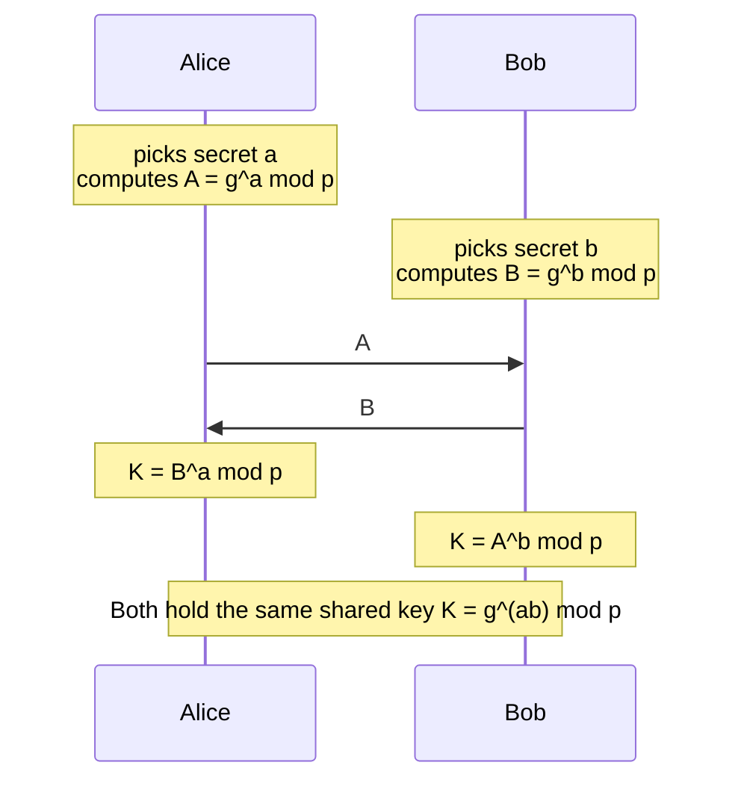

# $\textsf{Thimza}$ Scheme

## Notation
Let $`R_q=\mathbb{Z}_q[X]/(X^{\varphi}+1)`$ with $\varphi=512$ and the prime $q=2^{49}-2^{41}+1$.
Vectors are in $R_q^{\ell}$ or $R_q^{k}$, $\mathbf{A}\in R_q^{k\times\ell}$ is expanded from a public
seed, $D_\sigma$ is the discrete Gaussian of width $\sigma$, and $\lfloor\mathbf{x}\rceil_{\nu}$ drops the
$\nu$ low-order bits of every coefficient. $\mathcal{C}$ is the challenge set (polynomials with exactly
$\omega$ nonzero coefficients, each in $\{\pm1\}$), $\alpha_1,\dots,\alpha_n\in R_q$ are public evaluation points
whose differences are units, and $\lambda_{T,i}$ is the Lagrange coefficient of $i$ for the set $T$ at
$0$. The hash functions $H_0,H_1$ (output $n_H=5\lambda$ bits), $H_c$ (into $\mathcal{C}$) and the PRF
(into $R_q^{\ell}$) are SHAKE256 with domain separation.

## Procedures

**Key generation.** A trusted dealer samples
$(\mathbf{s},\mathbf{e})\leftarrow D_{\sigma_t}^{\ell}\times D_{\sigma_t}^{k}$, publishes
$\mathsf{vk}=(\mathsf{seed},\mathbf{t})$ with $\mathbf{t}=\lfloor\mathbf{A}\mathbf{s}+\mathbf{e}\rceil_{\nu_t}$,
shares $\mathbf{s}$ with a uniform polynomial of degree $t-1$,

$$\mathbf{s}_i=\mathbf{s}+\sum_{u=1}^{t-1}\alpha_i^{u}\,\mathbf{p}_u,\qquad \mathbf{p}_u\leftarrow R_q^{\ell},$$

and gives every unordered pair $\{i,j\}$ a common seed $\mathsf{sd}_{\{i,j\}}$, so that
$`\mathsf{sk}_i=(\mathbf{s}_i,(\mathsf{sd}_{\{i,j\}})_{j\ne i})`$.

**Round 1** (independent of the signer set). Signer $i$ samples a nonce
$`(\mathbf{r}_i,\mathbf{e}_i')\leftarrow D_{\sigma_w}^{\ell}\times D_{\sigma_w}^{k}`$, truncates its commitment to
$`\bar{\mathbf{w}}_i=\lfloor\mathbf{A}\mathbf{r}_i+\mathbf{e}_i'\rceil_{\nu_c}`$, stores a token of phase $1$ and sends

$$\mathsf{cmt}_i=H_0(\mathsf{vk},\mu,i,\bar{\mathbf{w}}_i).$$

**Round 2** (binding the request). On a request $`V=(\mu,T,(\mathsf{cmt}_j)_{j\in T})`$ with $|T|=t$,
$i\in T$ and its own first message at index $i$, signer $i$ stores the digest
$`\mathsf{vw}=H_1(\mathsf{vk},\mu,T,(\mathsf{cmt}_j)_{j\in T})`$ and only then sends $\bar{\mathbf{w}}_i$.

**Round 3** (checking, responding, erasing). Signer $i$ checks the digest and every opening,
$`\mathsf{cmt}_j=H_0(\mathsf{vk},\mu,j,\bar{\mathbf{w}}_j)`$ for all $j\in T$, and computes

$$\mathbf{w}=\Big\lfloor\sum_{j\in T}2^{\nu_c}\bar{\mathbf{w}}_j\Big\rceil_{\nu_w},\qquad c=H_c(\mathsf{vk},\mathbf{w},\mu),$$

$$\mathbf{m}_i=\sum_{j\in T\setminus\{i\}}\varepsilon_{ij}\,\mathsf{PRF}(\mathsf{sd}_{\{i,j\}},\mathsf{vw}),\qquad \varepsilon_{ij}=-\varepsilon_{ji}=1\ \text{for}\ i<j,$$

$$\mathbf{z}_i=c\,\lambda_{T,i}\,\mathbf{s}_i+\mathbf{r}_i+\mathbf{m}_i,$$

erases the token and sends $`\mathbf{z}_i`$. The masks are keyed by the digest of the request, not by a
session identifier, and their antisymmetry gives $`\sum_{i\in T}\mathbf{m}_i=\mathbf{0}`$.

**Combining and verification.** With $`\mathbf{z}=\sum_{i\in T}\mathbf{z}_i=c\,\mathbf{s}+\sum_{i\in T}\mathbf{r}_i`$ and the hint
$`\mathbf{h}=\mathbf{w}-\lfloor\mathbf{A}\mathbf{z}-2^{\nu_t}c\,\mathbf{t}\rceil_{\nu_w}`$ (centred modulo $`q_{\nu_w}`$), the signature is
$`\sigma=(c,\mathbf{z},\mathbf{h})`$, and the Raccoon verifier with bound $B$ accepts if and only if

$$c=H_c\big(\mathsf{vk},\ \lfloor\mathbf{A}\mathbf{z}-2^{\nu_t}c\,\mathbf{t}\rceil_{\nu_w}+\mathbf{h},\ \mu\big)\ \wedge\ \big\|(\mathbf{z},\,2^{\nu_w}\mathbf{h})\big\|_2\le B .$$

The shared key is $K = g^{ab} \bmod p$.
