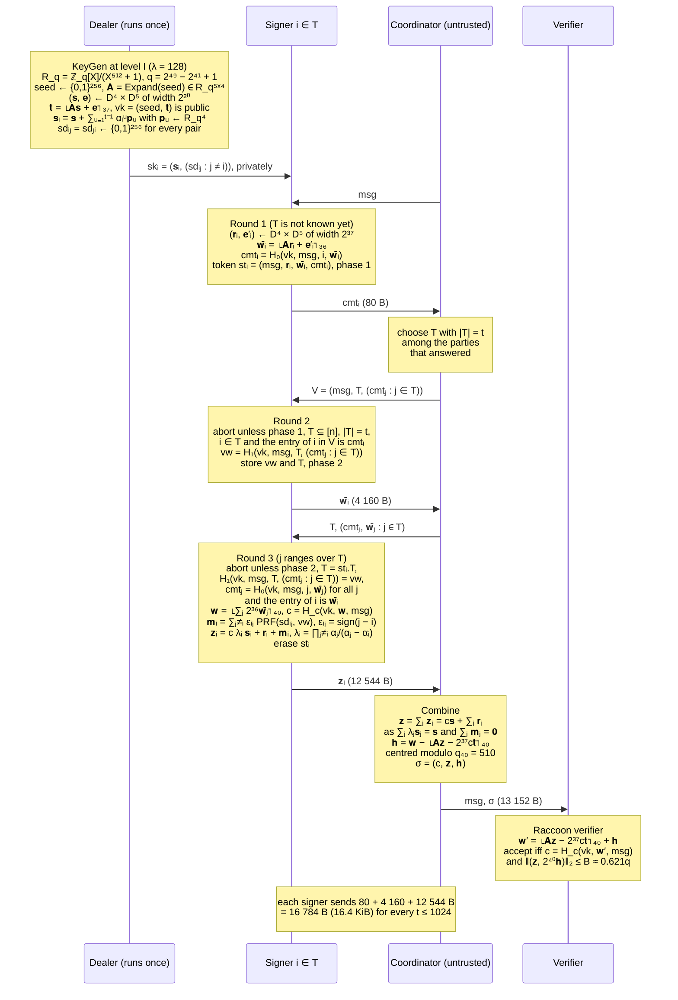

# $\textsf{Thimza}$ Scheme

## Notation
Let $`R_q=\mathbb{Z}_q[X]/(X^{\varphi}+1)`$ with $`\varphi=512`$ and the prime $`q=2^{49}-2^{41}+1`$.
Vectors are in $`R_q^{\ell}`$ or $`R_q^{k}`$, $`\mathbf{A}\in R_q^{k\times\ell}`$ is expanded from a public
seed, $`D_\sigma`$ is the discrete Gaussian of width $`\sigma`$, and $`\lfloor\mathbf{x}\rceil_{\nu}`$ drops the
$`\nu`$ low-order bits of every coefficient. $`\mathcal{C}`$ is the challenge set (polynomials with exactly
$`\omega`$ nonzero coefficients, each in $`\{\pm1\}`$), $`\alpha_1,\dots,\alpha_n\in R_q`$ are public evaluation points
whose differences are units, and $`\lambda_{T,i}`$ is the Lagrange coefficient of $`i`$ for the set $`T`$ at
$`0`$. The hash functions $`H_0,H_1`$ (output $`n_H=5\lambda`$ bits), $`H_c`$ (into $`\mathcal{C}`$) and the PRF
(into $`R_q^{\ell}`$) are SHAKE256 with domain separation.

## Procedures

**Key generation.** A trusted dealer samples
$`(\mathbf{s},\mathbf{e})\leftarrow D_{\sigma_t}^{\ell}\times D_{\sigma_t}^{k}`$, publishes
$`\mathsf{vk}=(\mathsf{seed},\mathbf{t})`$ with $`\mathbf{t}=\lfloor\mathbf{A}\mathbf{s}+\mathbf{e}\rceil_{\nu_t}`$,
shares $`\mathbf{s}`$ with a uniform polynomial of degree $`t-1`$,
$`\mathbf{s}_i=\mathbf{s}+\sum_{u=1}^{t-1}\alpha_i^{u}\,\mathbf{p}_u, \text{ and } \mathbf{p}_u\leftarrow R_q^{\ell},`$
and gives every unordered pair $`\{i,j\}`$ a common seed $`\mathsf{sd}_{\{i,j\}}`$, so that
$`\mathsf{sk}_i=(\mathbf{s}_i,(\mathsf{sd}_{\{i,j\}})_{j\ne i})`$.

**Round 1** (independent of the signer set). Signer $`i`$ samples a nonce
$`(\mathbf{r}_i,\mathbf{e}_i')\leftarrow D_{\sigma_w}^{\ell}\times D_{\sigma_w}^{k}`$, truncates its commitment to
$`\bar{\mathbf{w}}_i=\lfloor\mathbf{A}\mathbf{r}_i+\mathbf{e}_i'\rceil_{\nu_c}`$, stores a token of phase $`1`$ and sends
$`\mathsf{cmt}_i=H_0(\mathsf{vk},\mu,i,\bar{\mathbf{w}}_i).`$

**Round 2** (binding the request). On a request $`V=(\mu,T,(\mathsf{cmt}_j)_{j\in T})`$ with $`|T|=t`$,
$`i\in T`$ and its own first message at index $`i`$, signer $`i`$ stores the digest
$`\mathsf{vw}=H_1(\mathsf{vk},\mu,T,(\mathsf{cmt}_j)_{j\in T})`$ and only then sends $`\bar{\mathbf{w}}_i`$.

**Round 3** (checking, responding, erasing). Signer $`i`$ checks the digest and every opening,
$`\mathsf{cmt}_j=H_0(\mathsf{vk},\mu,j,\bar{\mathbf{w}}_j)`$ for all $`j\in T`$, and computes

$$\mathbf{w}=\Big\lfloor\sum_{j\in T}2^{\nu_c}\bar{\mathbf{w}}_j\Big\rceil_{\nu_w},\qquad c=H_c(\mathsf{vk},\mathbf{w},\mu),$$

$$\mathbf{m}_i=\sum_{j\in T\setminus\{i\}}\varepsilon_{ij}\,\mathsf{PRF}(\mathsf{sd}_{\{i,j\}},\mathsf{vw}),\qquad \varepsilon_{ij}=-\varepsilon_{ji}=1\ \text{for}\ i<j,$$

$$\mathbf{z}_i=c\,\lambda_{T,i}\,\mathbf{s}_i+\mathbf{r}_i+\mathbf{m}_i,$$

erases the token and sends $`\mathbf{z}_i`$. The masks are keyed by the digest of the request, not by a
session identifier, and their antisymmetry gives $`\sum_{i\in T}\mathbf{m}_i=\mathbf{0}`$.

**Combining and verification.** With $`\mathbf{z}=\sum_{i\in T}\mathbf{z}_i=c\,\mathbf{s}+\sum_{i\in T}\mathbf{r}_i`$ and the hint
$`\mathbf{h}=\mathbf{w}-\lfloor\mathbf{A}\mathbf{z}-2^{\nu_t}c\,\mathbf{t}\rceil_{\nu_w}`$ (centred modulo $`q_{\nu_w}`$), the signature is
$`\sigma=(c,\mathbf{z},\mathbf{h})`$, and the Raccoon verifier with bound $`B`$ accepts if and only if
$`c=H_c\big(\mathsf{vk},\ \lfloor\mathbf{A}\mathbf{z}-2^{\nu_t}c\,\mathbf{t}\rceil_{\nu_w}+\mathbf{h},\ \mu\big)\ \wedge\ \big\|(\mathbf{z},\,2^{\nu_w}\mathbf{h})\big\|_2\le B .`$

## $`\textsf{Thimza}`$'s Protocol

A trusted dealer runs $`\mathsf{KeyGen}`$ once. It samples a Raccoon key $`\mathsf{vk}=(\mathsf{seed},\mathbf{t})`$ with $`\mathbf{t}=\lfloor\mathbf{A}\mathbf{s}+\mathbf{e}\rceil_{\nu_t}`$, shares the secret $`\mathbf{s}`$ as $`\mathbf{s}_i=\mathbf{s}+\sum_{u=1}^{t-1}\alpha_i^{u}\mathbf{p}_u`$ and gives every pair of parties a common seed $`\mathsf{sd}_{\lbrace i,j\rbrace}`$. At level I, for $`\lambda=128`$, the ring is $`R_q=\mathbb{Z}_q[X]/(X^{512}+1)`$ with $`q=2^{49}-2^{41}+1`$ and $`(\ell,k)=(4,5)`$, the widths are $`\sigma_t=2^{20}`$ and $`\sigma_w=2^{37}`$, the rounding amounts are $`(\nu_t,\nu_w,\nu_c)=(37,40,36)`$ and a challenge has $`\omega=19`$ nonzero coefficients, which gives $`124`$ bits of MLWE hardness and $`156`$ bits of SelfTargetMSIS hardness for $`Q_s=2^{60}`$ signing queries. In round 1, which needs only the message $`\mathsf{msg}`$, signer $`i`$ samples a nonce $`(\mathbf{r}_i,\mathbf{e}_i')`$, keeps it in a token and sends the hash $`\mathsf{cmt}_i`$ of its truncated commitment $`\bar{\mathbf{w}}_i=\lfloor\mathbf{A}\mathbf{r}_i+\mathbf{e}_i'\rceil_{\nu_c}`$ in $`80`$ bytes. An untrusted coordinator chooses a signer set $`T`$ of $`t`$ parties that answered and sends them the request $`V=(\mathsf{msg},T,(\mathsf{cmt}_j)_{j\in T})`$. In round 2 signer $`i`$ checks $`V`$, stores its digest $`\mathsf{vw}=H_1(\mathsf{vk},\mathsf{msg},T,(\mathsf{cmt}_j)_{j\in T})`$ and only then opens $`\bar{\mathbf{w}}_i`$ in $`4160`$ bytes, so every corrupt opening is fixed before an honest one is revealed. In round 3 it checks every opening against its first message and the request against $`\mathsf{vw}`$, computes $`\mathbf{w}=\lfloor\sum_{j\in T}2^{\nu_c}\bar{\mathbf{w}}_j\rceil_{\nu_w}`$ and $`c=H_c(\mathsf{vk},\mathbf{w},\mathsf{msg})`$, sends $`\mathbf{z}_i=c\lambda_{T,i}\mathbf{s}_i+\mathbf{r}_i+\mathbf{m}_i`$ in $`12544`$ bytes and erases the token, where the Lagrange coefficient $`\lambda_{T,i}`$ of $`i`$ for $`T`$ is written $`\lambda_i`$ in the diagram. The mask $`\mathbf{m}_i=\sum_{j\in T\setminus\lbrace i\rbrace}\varepsilon_{ij}\mathsf{PRF}(\mathsf{sd}_{\lbrace i,j\rbrace},\mathsf{vw})`$ is keyed by the digest of the request instead of a session identifier, and the signs $`\varepsilon_{ij}=-\varepsilon_{ji}`$ make the masks of one request cancel, so $`\mathbf{z}=\sum_{j\in T}\mathbf{z}_j=c\mathbf{s}+\sum_{j\in T}\mathbf{r}_j`$ is a Raccoon response, while signers that were shown different requests obtain masks that do not cancel and whose sum is uniform, which is why the channels need no authentication. The combiner computes the hint $`\mathbf{h}=\mathbf{w}-\lfloor\mathbf{A}\mathbf{z}-2^{\nu_t}c\mathbf{t}\rceil_{\nu_w}`$, and the unmodified Raccoon verifier accepts the signature $`\sigma=(c,\mathbf{z},\mathbf{h})`$ of $`13152`$ bytes. A signer thus sends $`16784`$ bytes, or $`16.4`$ KiB, for every $`t\le1024`$ and keeps one token per open session.
